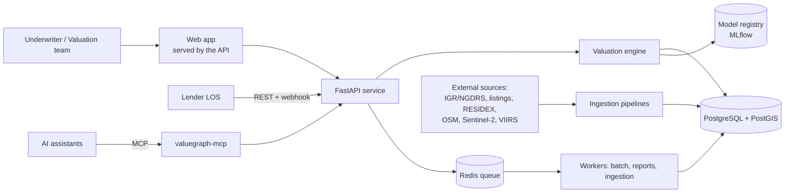
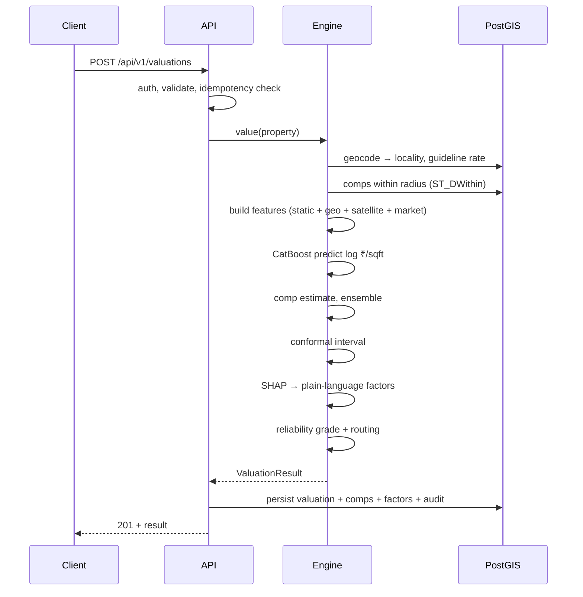

# Architecture — ValueGraph AI

## 0. Implementation status (v0.1 — what the code does today)

The sections below describe the target. The current build deliberately takes the simplest option that fully works:

| Target | v0.1 implementation | Upgrade when |
|---|---|---|
| PostGIS radius search | Same-locality comparables weighted by size/BHK similarity, plus a neighbourhood price level from geocoded localities within 3 km (scikit-learn BallTree), in memory | Listing-level coordinates arrive — then radius search in PostGIS |
| Engine package of 10 modules | `model.py` (comps, features, CatBoost, blend, conformal, SHAP→₹) + `engine.py` (grade, route, LTV) | Modules grow past ~400 lines |
| Normalized valuation/comps/factors tables | `valuation.result` JSON — an immutable document, replayable as returned | Analytics need SQL over factors |
| Alembic migrations | `create_all` on startup | Before the first schema change on a live DB |
| Redis queue, workers, batch, webhooks, PDF | Not built | Lender integration starts |
| MLflow registry | `models/model.joblib` + `models/eval_report.json` | More than one person trains models |
| Satellite / OSM / infra features | Locality centroids geocoded once from OpenStreetMap Nominatim (`data/geo/locality_coords.csv`); no satellite or infrastructure layers yet | Residuals cluster spatially |
| Fixed-width intervals | Normalised split-conformal: a second CatBoost model predicts each property's typical error; grade cut-offs calibrated to median-error targets and verified on held-out data | Transaction labels arrive (recalibrate) |
| Time split | Unseen-locality holdout + random split that keeps re-listings together (dataset has no dates) | Dated listings or transactions arrive |
| Monotone constraints | Behaviour test asserts bigger flat → higher value | Test ever fails |

## 1. Context



## 2. Components

| Component | Responsibility | Tech |
|---|---|---|
| **Dashboard** | Forms, reports, queue, evaluation pages | Vanilla JS web app served by the API (P1), Next.js (P2) |
| **API service** | Auth, validation, routing, persistence, audit | FastAPI, Pydantic v2, SQLAlchemy 2 |
| **Valuation engine** | Features → comps → model → interval → explain → grade | Python package `valuegraph.engine` |
| **Workers** | Batch valuations, PDF rendering, ingestion jobs, webhooks | `arq` (Redis) |
| **Database** | Listings, rates, geo, valuations, audit | PostgreSQL 16 + PostGIS 3 |
| **Model registry** | Versioned models, metrics, artifacts | MLflow |
| **Ingestion** | Pull, validate, dedup, normalize sources | Python + pandera |
| **MCP server** | Expose valuation tools to AI clients | Python MCP SDK |
| **Observability** | Logs, metrics, traces | structlog, Prometheus, OpenTelemetry |

## 3. Valuation request flow



## 4. Engine pipeline (inside `valuegraph/engine/`)

| Step | Module | Output |
|---|---|---|
| 1 Normalize | `normalize.py` | Area converted to built-up sqft (keeps original + type) |
| 2 Locate | `geo.py` | locality_id, h3 cell, guideline rate |
| 3 Comparables | `comparables.py` | top-k comps + weights + comp estimate |
| 4 Features | `features.py` | one feature vector (same code as training!) |
| 5 Predict | `model.py` | log(₹/sqft) point estimate |
| 6 Ensemble | `ensemble.py` | blended estimate (weights from validation) |
| 7 Interval | `uncertainty.py` | low/high at configured level (split-conformal, residuals per segment) |
| 8 Explain | `explain.py` | top-N factors in ₹ |
| 9 Grade | `reliability.py` | grade, reason codes, route |
| 10 Policy | `policy.py` | LTV basis, flags |

**Rule:** training and inference import the *same* `features.py`. Training/serving skew is the most common silent bug in AVMs.

## 5. ML lifecycle

```
ingest → validate (pandera) → dedup → feature build → time-split
→ train baselines + CatBoost → calibrate conformal on calibration split
→ evaluate on test split (by segment) → register in MLflow
→ promote (manual gate) → serve → monitor drift & back-test monthly
```

- Splits: train (oldest) / calibration / test (newest). Plus a **geographic holdout** of unseen localities.
- Promotion requires beating the current champion and all baselines on test.

## 6. Deployment

| Env | Shape |
|---|---|
| Local | `docker compose` — api, worker, db (postgis), redis, mlflow, dashboard |
| Demo | Single VM (e.g. 2 vCPU / 8 GB) with the same compose file |
| Pilot | Managed Postgres, containers behind a gateway, CI/CD, secrets manager |

Stateless API and workers scale horizontally; DB is the only stateful service. Model files load once at startup and are cached in memory.

## 7. Scaling across India
- **City = config + data.** `config/cities/<city>.yaml` holds bounding box, state rate source, comp radius defaults, LTV policy overrides.
- Models per **(region, segment)**; a global fallback model handles thin cities but always grades as *Low* until local data matures.
- Spatial indexing (GiST + H3 cell column) keeps comp search O(log n).
- Batch path for portfolio revaluation.

## 8. Cross-cutting concerns
- **Audit:** every valuation stores inputs, feature vector hash, model version, data snapshot id, rule version → replayable.
- **Security:** see `11-authentication-and-security.md`.
- **Config:** pydantic-settings from env; no secrets in code.
- **Failure modes:** model load failure → API returns 503 for valuations but health shows degraded; geocoder down → accept lat/lon only.
