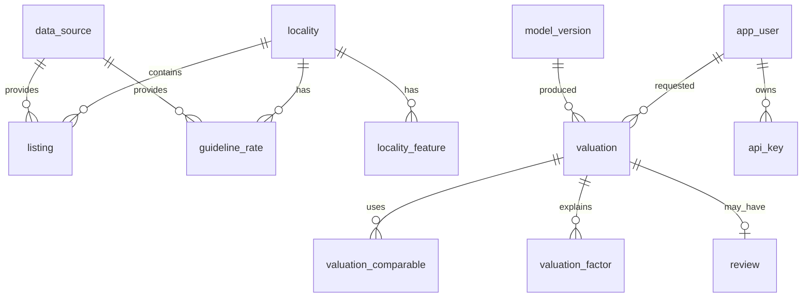

# Database — ValueGraph AI

> **v0.1:** the app database has 5 tables — `app_user`, `api_key`, `valuation` (request + full result JSON), `review`, `audit_log` (hash-chained) — defined in `src/valuegraph/api/db.py`. Listings live in `data/processed/listings.csv` and the in-memory comparables index. The PostGIS schema below is the target for when listings, rates and geo layers move into the database.

PostgreSQL 16 + PostGIS 3. Migrations via Alembic (+ GeoAlchemy2). All geometry in **SRID 4326**; distance queries cast to `geography` for metres.

## 1. Entity overview



## 2. Reference & market data

```sql
CREATE EXTENSION IF NOT EXISTS postgis;

CREATE TABLE data_source (
  id            SERIAL PRIMARY KEY,
  name          TEXT NOT NULL,             -- 'kaggle_house_price_india', 'ts_igr_rates'
  kind          TEXT NOT NULL,             -- listing | guideline | index | geo | satellite | transaction
  licence       TEXT NOT NULL,             -- e.g. 'ODbL', 'CC-BY-4.0', 'lender-confidential'
  url           TEXT,
  allowed_use   TEXT NOT NULL,             -- what we are permitted to do with it
  captured_at   TIMESTAMPTZ NOT NULL DEFAULT now()
);

CREATE TABLE locality (
  id            SERIAL PRIMARY KEY,
  city          TEXT NOT NULL,
  name          TEXT NOT NULL,
  name_aliases  TEXT[] DEFAULT '{}',       -- 'Gachibowli', 'Gachi Bowli'
  geom          GEOMETRY(MultiPolygon, 4326),
  centroid      GEOMETRY(Point, 4326),
  UNIQUE (city, name)
);
CREATE INDEX ON locality USING GIST (geom);

CREATE TABLE listing (
  id                 BIGSERIAL PRIMARY KEY,
  source_id          INT REFERENCES data_source(id),
  source_ref         TEXT,                  -- id/url at source
  locality_id        INT REFERENCES locality(id),
  geom               GEOMETRY(Point, 4326) NOT NULL,
  h3_r9              TEXT,
  property_type      TEXT NOT NULL CHECK (property_type IN
                     ('apartment','independent_house','villa','plot','office','retail')),
  area_value         NUMERIC NOT NULL,      -- as published
  area_type          TEXT NOT NULL CHECK (area_type IN
                     ('carpet','built_up','super_built_up','plot')),
  area_builtup_sqft  NUMERIC,               -- normalized
  bedrooms           SMALLINT,
  bathrooms          SMALLINT,
  age_years          NUMERIC,
  floor              SMALLINT,
  total_floors       SMALLINT,
  furnishing         TEXT,
  price_inr          NUMERIC NOT NULL,
  price_source       TEXT NOT NULL CHECK (price_source IN
                     ('asking','transaction','lender_valuation')),
  listed_on          DATE,
  status             TEXT,                  -- active | sold | withdrawn
  dup_group_id       BIGINT,                -- same physical listing across portals
  quality_flags      TEXT[] DEFAULT '{}',   -- 'price_outlier','geo_imprecise', ...
  ingested_at        TIMESTAMPTZ DEFAULT now()
);
CREATE INDEX ON listing USING GIST (geom);
CREATE INDEX ON listing (locality_id, property_type, listed_on);

CREATE TABLE guideline_rate (
  id               SERIAL PRIMARY KEY,
  source_id        INT REFERENCES data_source(id),
  locality_id      INT REFERENCES locality(id),
  state            TEXT NOT NULL,
  property_class   TEXT NOT NULL,          -- residential_flat | land | commercial ...
  rate_inr         NUMERIC NOT NULL,
  rate_unit        TEXT NOT NULL,          -- per_sqft | per_sqyd | per_sqm
  effective_from   DATE NOT NULL,
  effective_to     DATE,
  raw              JSONB                   -- original row for audit
);

CREATE TABLE market_index (           -- NHB RESIDEX etc.
  city         TEXT, series TEXT, period DATE, value NUMERIC,
  source_id    INT REFERENCES data_source(id),
  PRIMARY KEY (city, series, period)
);

CREATE TABLE poi (                    -- OSM amenities
  id BIGINT PRIMARY KEY, kind TEXT NOT NULL,  -- metro, school, hospital, mall, it_park
  name TEXT, geom GEOMETRY(Point, 4326) NOT NULL
);
CREATE INDEX ON poi USING GIST (geom);
CREATE INDEX ON poi (kind);

CREATE TABLE infra_project (          -- metro extensions, ring roads, airports
  id SERIAL PRIMARY KEY, name TEXT, kind TEXT,
  status TEXT,                        -- announced | under_construction | operational
  expected_completion DATE,
  geom GEOMETRY(Geometry, 4326),
  source_id INT REFERENCES data_source(id)
);

CREATE TABLE locality_feature (       -- precomputed, incl. satellite
  h3_r9        TEXT,
  as_of        DATE,
  ndvi_mean    NUMERIC,               -- greenness (Sentinel-2)
  builtup_frac NUMERIC,               -- built-up density
  ntl_radiance NUMERIC,               -- night lights (VIIRS)
  ntl_growth_3y NUMERIC,
  PRIMARY KEY (h3_r9, as_of)
);
```

## 3. Application data

```sql
CREATE TABLE app_user (
  id UUID PRIMARY KEY DEFAULT gen_random_uuid(),
  email CITEXT UNIQUE NOT NULL,
  password_hash TEXT NOT NULL,
  role TEXT NOT NULL CHECK (role IN ('admin','underwriter','reviewer','risk','integration')),
  is_active BOOLEAN DEFAULT true,
  created_at TIMESTAMPTZ DEFAULT now()
);

CREATE TABLE api_key (
  id UUID PRIMARY KEY DEFAULT gen_random_uuid(),
  user_id UUID REFERENCES app_user(id),
  prefix TEXT NOT NULL,                -- shown in UI, e.g. 'vg_live_ab12'
  key_hash TEXT NOT NULL,              -- never store raw key
  scopes TEXT[] NOT NULL,              -- 'valuations:write','valuations:read'
  expires_at TIMESTAMPTZ, revoked_at TIMESTAMPTZ
);

CREATE TABLE model_version (
  id TEXT PRIMARY KEY,                 -- 'cb-hyd-res-1.3.0'
  mlflow_run_id TEXT, trained_on DATE,
  ground_truth TEXT NOT NULL,          -- 'asking_proxy' | 'transaction'
  metrics JSONB, status TEXT           -- candidate | champion | retired
);

CREATE TABLE valuation (
  id TEXT PRIMARY KEY,                 -- 'VAL-2026-000123'
  requested_by UUID REFERENCES app_user(id),
  idempotency_key TEXT UNIQUE,
  input JSONB NOT NULL,
  geom GEOMETRY(Point, 4326),
  locality_id INT REFERENCES locality(id),
  model_version_id TEXT REFERENCES model_version(id),
  data_snapshot TEXT NOT NULL,         -- dataset version used
  rules_version TEXT NOT NULL,
  value_inr NUMERIC, low_inr NUMERIC, high_inr NUMERIC,
  interval_level NUMERIC,              -- 0.8
  rate_per_sqft NUMERIC,
  guideline_value_inr NUMERIC,
  reliability TEXT NOT NULL,           -- high|medium|low|insufficient_evidence
  route TEXT NOT NULL,                 -- auto|desktop_review|physical_inspection
  reason_codes TEXT[],
  feature_hash TEXT,
  created_at TIMESTAMPTZ DEFAULT now()
);

CREATE TABLE valuation_comparable (
  valuation_id TEXT REFERENCES valuation(id),
  listing_id BIGINT REFERENCES listing(id),
  distance_m NUMERIC, weight NUMERIC, adj_rate_per_sqft NUMERIC,
  PRIMARY KEY (valuation_id, listing_id)
);

CREATE TABLE valuation_factor (
  valuation_id TEXT REFERENCES valuation(id),
  feature TEXT, label TEXT, contribution_inr NUMERIC, rank SMALLINT,
  PRIMARY KEY (valuation_id, feature)
);

CREATE TABLE review (
  id SERIAL PRIMARY KEY,
  valuation_id TEXT UNIQUE REFERENCES valuation(id),
  status TEXT NOT NULL,                -- open|assigned|accepted|overridden|site_visit
  assignee UUID REFERENCES app_user(id),
  override_value_inr NUMERIC, override_reason TEXT,
  updated_at TIMESTAMPTZ DEFAULT now()
);

CREATE TABLE audit_log (               -- append-only
  id BIGSERIAL PRIMARY KEY,
  at TIMESTAMPTZ DEFAULT now(),
  actor TEXT, action TEXT, entity TEXT, entity_id TEXT,
  detail JSONB, prev_hash TEXT, hash TEXT  -- hash chain = tamper evidence
);
REVOKE UPDATE, DELETE ON audit_log FROM PUBLIC;
```

## 4. Key queries

**Comparables within radius**
```sql
SELECT id, ST_Distance(geom::geography, :pt::geography) AS d_m, ...
FROM listing
WHERE property_type = :ptype
  AND dup_group_id IS DISTINCT FROM :exclude_group
  AND listed_on >= :since
  AND ST_DWithin(geom::geography, :pt::geography, :radius_m)
ORDER BY d_m LIMIT 50;
```
> `ST_MakePoint(lon, lat)` — **longitude first**. Swapped coords put Hyderabad in Somalia.

**Nearest metro distance**
```sql
SELECT MIN(ST_Distance(p.geom::geography, :pt::geography))
FROM poi p WHERE kind = 'metro';
```
For speed, use the KNN operator: `ORDER BY p.geom <-> :pt LIMIT 1`.

## 5. Conventions
- Raw files are immutable in `data/raw/`; DB holds normalized data with `source_id` back-links.
- Never delete listings — mark `status`/`quality_flags`. Dedup groups, don't drop.
- Money as `NUMERIC` in rupees (no floats, no lakh units in DB).
- `data_snapshot` = date-stamped tag of the dataset version used for training/serving.
- Retention: valuation + audit kept per lender policy (configurable); no borrower PII stored in v1.
